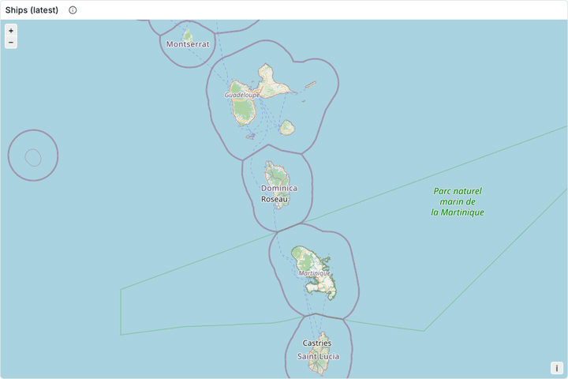
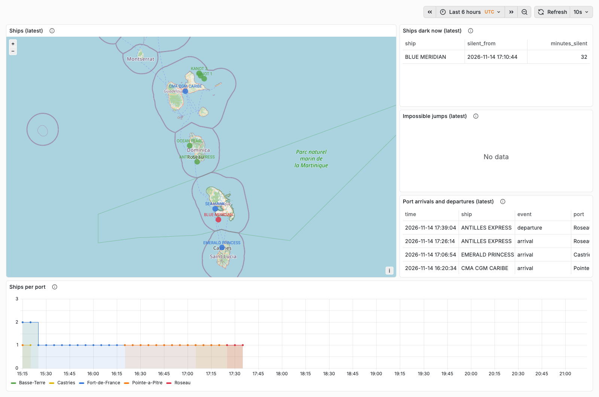
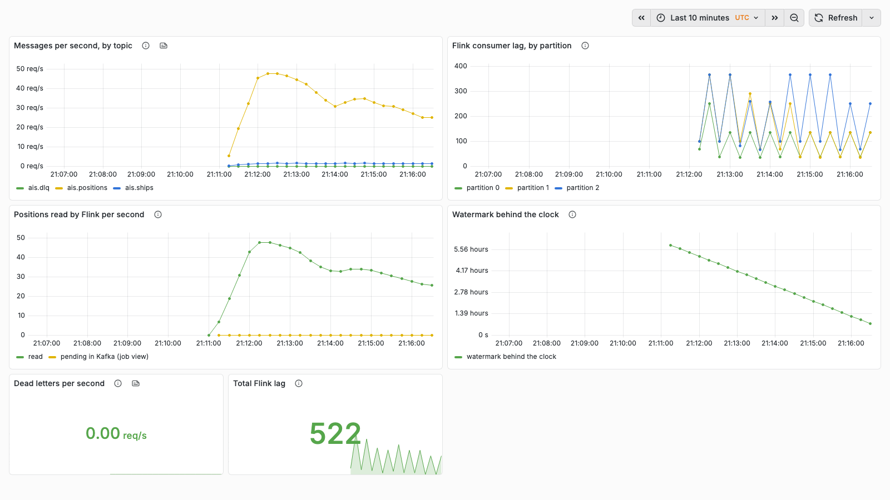

# Caribbean AIS Stream

Real-time ship traffic around the **Lesser Antilles**, from the AIS radio broadcasts of
every large ship to **Kafka**, then **Flink**. Ships report their position every few
seconds under way and their identity every six minutes; this project turns that stream into
clean, keyed Kafka records, then Flink SQL turns those into port activity, per-ship
statistics and anomalies (ships going dark, impossible position jumps, port arrivals and
departures) on event time, upserted into PostgreSQL, shown on a live map in Grafana.



Third piece of a portfolio on the same islands, after
[antilles-data-pipeline](https://github.com/tomtessondev/antilles-data-pipeline) (batch) and
[caribbean-sensor-pipeline](https://github.com/tomtessondev/caribbean-sensor-pipeline) (IoT).

## Architecture

```
 aisstream.io (WebSocket) ─┐                              ┌─► ais.positions   (keyed by MMSI, 7 days)
 recording (JSON lines) ───┼─► normalise (pydantic) ──────┼─► ais.ships       (compacted: latest per ship)
 synthetic traffic ────────┘   AIS sentinels → null       └─► ais.dlq         (rejects, verbatim)
                                                                   │
                                     Flink SQL: event time, watermark 30 s, idle partitions
                                       ├─ tumbling 5 min per port area ──► port_activity   (PostgreSQL,
                                       ├─ tumbling 1 h per ship ──────────► ship_hourly      upserted)
                                       ├─ session 15 min per ship ────────► ship_sessions ┐
                                       ├─ MATCH_RECOGNIZE: gap > 15 min ──► ais_gaps ─────┴► dark_periods (view)
                                       ├─ MATCH_RECOGNIZE: > 60 kn ───────► position_jumps
                                       ├─ MATCH_RECOGNIZE: in/out of port ► port_events
                                       └─ every position (upsert) ────────► ship_positions
                                                                                 │
 Kafka exporter (offsets, consumer lag) ─┐                                       │ read-only role
 Flink reporter (records/s, watermark) ──┴─► Prometheus ──────────────────► Grafana: map, stream health
```

| Part | Tooling | Where |
| --- | --- | --- |
| Records | AIS normalisation, pydantic models | `src/ais_stream/messages.py` |
| Sources | aisstream.io client with reconnection, replay of recordings | `src/ais_stream/sources.py` |
| Producer | confluent-kafka: keyed, idempotent, acks=all, zstd | `src/ais_stream/kafka.py`, `pipeline.py` |
| Synthetic traffic | Ferries, cargo, cruise, tanker at anchor, fishing boats, a ship going dark, a spoofed position | `src/ais_stream/synthetic.py` |
| Stream processing | Flink 1.20 SQL: Kafka source, window TVFs (tumbling, session), `MATCH_RECOGNIZE`, JDBC/PostgreSQL upsert sinks | `flink/sql/ais_jobs.sql`, `flink/Dockerfile`, `postgres/init.sql` |
| Dashboards | Grafana 12 provisioned as code: geomap of the ships, anomalies, port activity, stream health | `grafana/` |
| Metrics | Prometheus scraping a Kafka exporter (broker view) and Flink's Prometheus reporter (job view) | `prometheus/prometheus.yml` |
| Platform | Kafka 3.9 (KRaft, single node), Kafka UI, Flink, PostgreSQL, Docker Compose | `docker-compose.yml` |
| Quality | pytest (unit, a fake WebSocket server, a real Kafka, end to end through Flink), ruff, mypy `--strict` | `tests/`, `.github/workflows/ci.yml` |

## Quick start

```bash
docker compose up -d --build     # Kafka, Flink, PostgreSQL, synthetic ships at the real pace
open http://localhost:8088       # Kafka UI: topics, partitions, messages
open http://localhost:8082       # Flink UI: the running job, watermarks, checkpoints
open http://localhost:3002       # Grafana: map of the ships, stream health (no login)
open http://localhost:9090       # Prometheus
docker compose exec postgres psql -U ais -c "select * from port_activity order by window_start desc limit 10"
```

Windows close as event time moves on: the first 5-minute port windows appear about five
minutes after start. The `db-schema` service applies `postgres/init.sql` on every start
(it only adds what is missing), so a database kept from an older version gets the newer
tables and the Grafana role before the Flink job writes to them. `make fast-replay` plays
six hours of traffic sixty times faster on a fresh stack (it wipes the volumes), to see the
ships move.

## Map and metrics

Two Grafana dashboards, provisioned from `grafana/` (the JSON files are the source of truth;
edits in the UI are not kept):

- **AIS traffic**: the ships at their latest position (red: dark, orange: impossible jump in
  the last 30 minutes, blue: moored or at anchor, green: under way), the ships dark now, the
  latest jumps and port arrivals and departures, and the ships per port over time. Panels
  marked "latest" are anchored on the most recent position received, not on the clock, so
  they also work on a replay. Grafana reads PostgreSQL with a role that can only select.
- **Stream health**: messages per second per topic, the Flink consumer lag per partition,
  positions read by Flink per second, how far the watermark is behind the clock, dead
  letters. The lag comes from the broker (Kafka exporter), so it stays visible while the job
  is down; Flink commits its offsets on checkpoints, so it moves in 30-second steps.





The end-to-end tests run every SQL query of the dashboards as Grafana's role, check that a
dark ship stays on the map, and validate every PromQL query against Prometheus.
[docs/images/README.md](docs/images/README.md) explains how to redo the images.

## Anomaly detection

| Anomaly | How | Result |
| --- | --- | --- |
| A ship goes dark | Session window per ship with a 15-minute gap: the session closes, and its row is written, 15 minutes after the last position. Ships under way report every few seconds, moored ones every 3 minutes. | `ship_sessions` (the alert) |
| ... and comes back | `MATCH_RECOGNIZE`: two consecutive positions more than 15 minutes apart, written when the ship reports again. | `ais_gaps`; the view `dark_periods` joins both: start, end (null while still dark), length, last position |
| Impossible jump | `MATCH_RECOGNIZE`: two consecutive positions more than 1 nm apart at an implied speed above 60 knots (fast ferries do about 40). | `position_jumps` |
| Port arrival / departure | `MATCH_RECOGNIZE` on the port areas: outside then inside, inside then outside. A ship first seen in port gets no arrival. | `port_events` |

```bash
docker compose exec postgres psql -U ais -c "select * from dark_periods"
docker compose exec postgres psql -U ais -c "select * from port_events order by event_time desc limit 10"
```

The synthetic traffic exercises each one: BLUE MERIDIAN goes silent for 45 minutes,
OCEAN PEARL reports one position 30 nm off its track. Known limitation: on the live feed,
a ship that leaves the covered area also stops reporting and shows as dark. The demo
generates its traffic as it plays, a year of it in one run: restarting it sends every ship
back to the start of its route, which the detections would rightly flag as jumps.
Loitering is left for later.

With the real feed (free key from [aisstream.io](https://aisstream.io)):

```bash
echo "AISSTREAM_API_KEY=..." > .env
docker compose --profile live up -d --build live
```

Development:

```bash
python -m venv .venv && source .venv/bin/activate
make install        # pip install -e ".[dev]"
make check          # ruff, mypy, unit tests
make integration    # tests against a real Kafka broker (needs Docker)
make e2e-up e2e     # fresh Kafka + Flink + PostgreSQL, then the end-to-end tests
ais-stream synthesize --hours 6 --out data/sample.jsonl
ais-stream replay data/sample.jsonl --bootstrap localhost:9094
```

## Design choices

- **Normalise once, at the edge.** AIS says "not available" with impossible values:
  heading 511, speed 102.3 knots, course 360, latitude 91, longitude 181. They become nulls
  before anything is written, so no downstream query averages a 511° heading. Names lose
  the `@` padding; a ship's length is the sum of the antenna's distances to bow and stern.
- **Keyed by ship.** The Kafka key is the MMSI: all of a ship's messages go to one
  partition, so consumers read them in order (tested on a real broker).
- **No loss, no duplicate from the producer.** `acks=all` with idempotence: a retried send
  is written exactly once. Delivery callbacks count failures; a replay exits non-zero if any.
- **Topics shaped like their data.** Positions are an event log kept a week. Ships are a
  table: a compacted topic keeps the latest description of each ship, so a new consumer can
  rebuild the fleet from Kafka alone. Rejects go to a dead-letter topic, verbatim.
- **Development without an account.** The synthetic generator writes aisstream's exact
  format, so `demo` and `replay` go through the same parsing as the live feed. It includes
  a ship going dark and a spoofed position, so every anomaly detection has a case to catch.
- **A broken key stops the producer.** aisstream answers an invalid key with an error
  message instead of data; the producer raises instead of filling the dead-letter topic.
- **Event time, not arrival time.** Windows use the time the ship sent the position, with a
  30-second watermark for out-of-order messages. Three partitions and a handful of ships
  mean some partitions go quiet; without `table.exec.source.idle-timeout` a silent
  partition would hold the watermark back and no window would ever close.
- **Port areas in the query, not in a join.** A regular join with a table of ports would
  drop the event-time attribute that windows need; a `CASE` over boxes around each harbour
  keeps it.
- **Results that survive a restart.** Each sink table has the primary key Flink upserts on.
  The end-to-end test cancels the job, submits it again from the earliest offset, and
  checks the tables come out identical. Re-sending the same traffic would not test this:
  events older than the watermark are late and dropped, which the first version of the
  test learned the hard way.
- **The end-to-end test starts the job after its traffic.** Submitted first, the job waits
  long enough for every partition to be marked idle; when hours of traffic then arrive at
  once, the first partition read pushes the watermark ahead alone and the others' first
  hour is late. Started on a backlog, the job reads all partitions together.
- **Session windows keep a row, not a `LAST_VALUE`.** Session windows merge as positions
  arrive, and `LAST_VALUE` cannot be merged; window deduplication (`ROW_NUMBER` over the
  session, latest first) keeps the last position instead.
- **Two infrastructure traps, now written down.** The Kafka connector does not bundle the
  zstd codec the producer uses (the Flink image adds `zstd-jni`), and the `apache/kafka`
  image writes to `/tmp` unless `KAFKA_LOG_DIRS` points at the volume, so a
  `docker compose down` silently emptied the topics.

## Roadmap

See [docs/ROADMAP.md](docs/ROADMAP.md).

## Author

Tom Tesson, data engineer and FPGA/embedded engineer, based in Guadeloupe (UTC−4).
